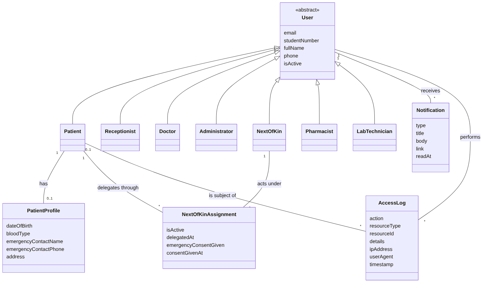
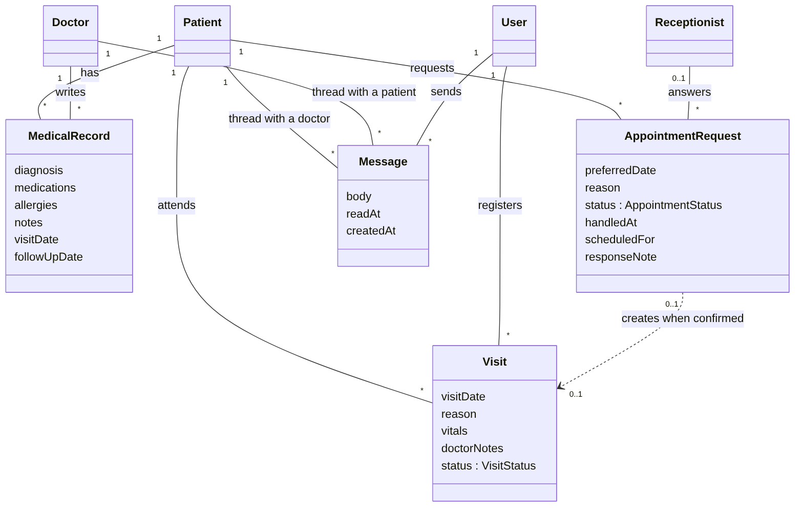
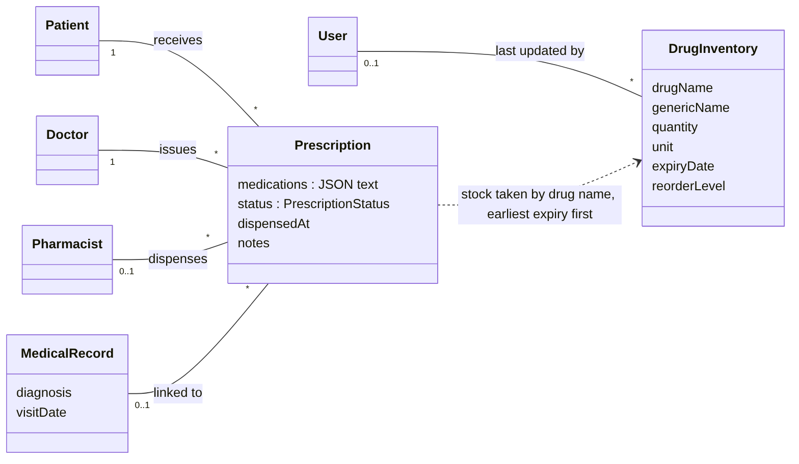
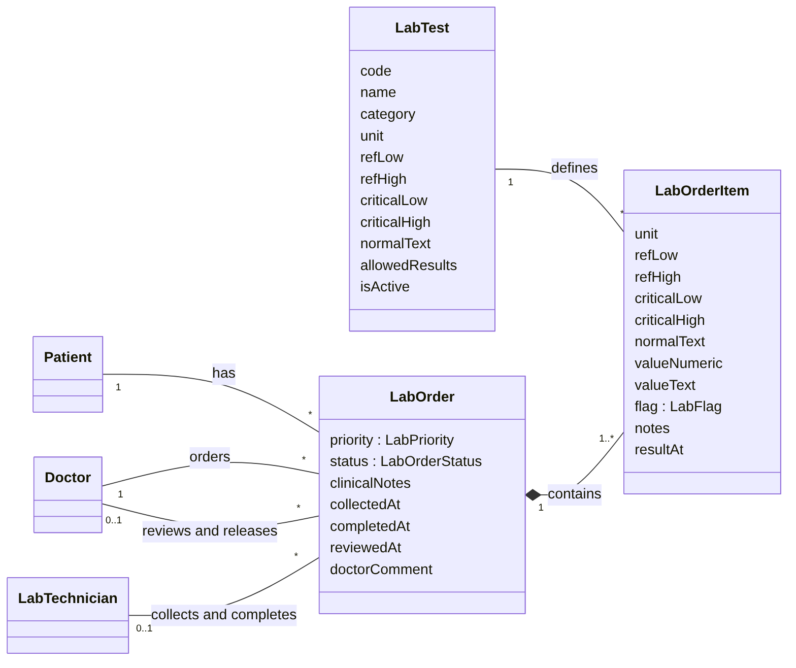
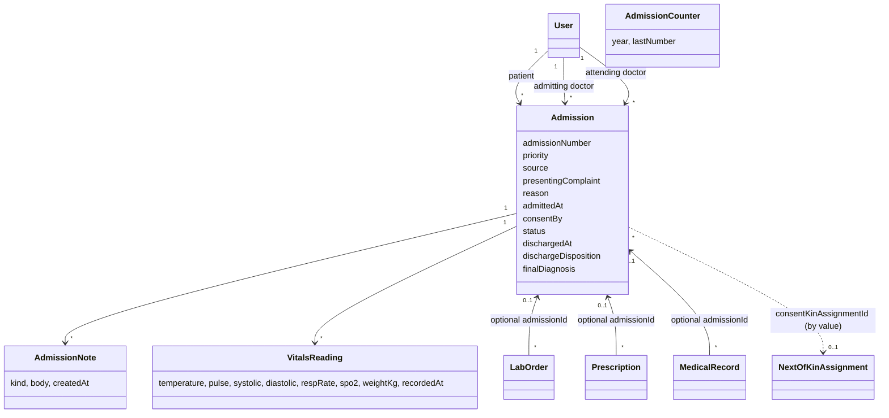

# MediVault Domain Model

A conceptual domain model for the MediVault patient portal (UNZA Clinic).
It was reverse-engineered from `prisma/schema.prisma` plus the business rules in `src/lib/*` and the role checks in `src/app/api/*`.

## How to read this

- A **domain model** shows the real-world things the system is about (patients, doctors, prescriptions, lab orders) and how they relate. It is not the database diagram, although here the two are very close.
- The model is split into four views so each one stays readable. Every view comes as `.png` (for reports), `.svg` (scalable) and `.mmd` (Mermaid source you can edit).
- **Roles are drawn as subclasses of User.** In the database there is a single `User` table with a `role` column (`Role` enum). Drawing `Patient`, `Doctor`, etc. as subclasses shows who does what. Where the schema only says "User" (for example `Visit.createdBy`), the diagram uses `User`.
- Multiplicities: `1` exactly one, `0..1` optional, `*` zero or more, `1..*` one or more.
- Every entity also has an `id` (generated `cuid`). Most have `createdAt` and `updatedAt`; these are left out of the diagrams.

## View 1: People, delegated consent, notifications and audit

## View 2: Clinical care

## View 3: Pharmacy

## View 4: Laboratory

## View 5: Inpatient admissions

Source (Mermaid, renders on GitHub and in most Markdown viewers). The `.png`/`.svg` for the other four views are generated with `mmdc`; this view is kept as source only until it is regenerated the same way.

---

## Entity catalogue

### People

| Entity | Purpose | Attributes |
| --- | --- | --- |
| **User** (abstract) | Anyone who can log in. One table, specialised by `role`. | `email` (unique), `studentNumber` (optional, unique), `passwordHash`, `role`, `fullName`, `phone`, `isActive` |
| Patient | A student receiving care. Has a student number and a profile. | (User attributes) |
| Receptionist | Verifies students, registers visits, answers appointment requests. | (User attributes) |
| Doctor | Writes medical records, issues prescriptions, orders and releases lab results, messages patients. | (User attributes) |
| Administrator | Manages accounts and reads access logs. Can also act in the receptionist, lab and pharmacy flows (the routes allow `ADMIN`). | (User attributes) |
| NextOfKin | A person a patient has delegated to for emergency consent. | (User attributes) |
| Pharmacist | Dispenses prescriptions and maintains drug inventory. | (User attributes) |
| LabTechnician | Collects samples and records lab results. | (User attributes) |
| **PatientProfile** | Extra personal details for a patient. Its primary key is the user's id, so it is strictly one-to-one with a Patient and is deleted with the user. | `dateOfBirth`, `bloodType`, `emergencyContactName`, `emergencyContactPhone`, `address` |

### Delegated consent and accountability

| Entity | Purpose | Attributes |
| --- | --- | --- |
| **NextOfKinAssignment** | The link between a patient and the person they delegate to. This is an association class: it carries data about the relationship itself. | `isActive`, `delegatedAt`, `emergencyConsentGiven`, `consentGivenAt` |
| **AccessLog** | One audit entry: who did what to which resource, and when. | `action`, `resourceType`, `resourceId`, `details`, `ipAddress`, `userAgent`, `timestamp`; links to the acting User and (optionally) the target Patient |
| **Notification** | A short in-app message shown in the bell menu. | `type`, `title`, `body`, `link`, `readAt` |

### Clinical care

| Entity | Purpose | Attributes |
| --- | --- | --- |
| **MedicalRecord** | A doctor's entry for a patient: diagnosis, medications, allergies. | `diagnosis`, `medications`, `allergies`, `notes`, `visitDate`, `followUpDate` |
| **Visit** | One clinic attendance by a patient. | `visitDate`, `reason`, `vitals`, `doctorNotes`, `status` (`VisitStatus`) |
| **AppointmentRequest** | A patient asks for a date; a receptionist confirms or declines. | `preferredDate`, `reason`, `status` (`AppointmentStatus`), `handledAt`, `scheduledFor`, `responseNote`, `visitId` |
| **Message** | One message in a private thread between one patient and one doctor. | `body`, `readAt`; links to the patient, the doctor and the sender |

### Pharmacy

| Entity | Purpose | Attributes |
| --- | --- | --- |
| **Prescription** | A doctor's order for medication, optionally tied to a medical record. | `medications` (JSON text), `status` (`PrescriptionStatus`), `dispensedAt`, `notes`; links to patient, doctor, optional pharmacist and optional medical record |
| **DrugInventory** | A stock line for a drug in the clinic pharmacy. | `drugName`, `genericName`, `quantity`, `unit`, `expiryDate`, `reorderLevel`; optional link to the user who last updated it |

### Laboratory

| Entity | Purpose | Attributes |
| --- | --- | --- |
| **LabTest** | The catalogue of tests the lab can run, with normal and critical ranges. | `code` (unique), `name`, `category`, `unit`, `refLow`, `refHigh`, `criticalLow`, `criticalHigh`, `normalText`, `allowedResults`, `isActive` |
| **LabOrder** | A doctor's request for one or more tests for a patient. Tracks who collected, completed and reviewed it. | `priority` (`LabPriority`), `status` (`LabOrderStatus`), `clinicalNotes`, `collectedAt`, `completedAt`, `reviewedAt`, `doctorComment`; links to patient, ordering doctor, and optional collector, completer, reviewer |
| **LabOrderItem** | One test inside an order, plus its result once the lab has run it. Owned by the order (deleted with it). | `unit`, `refLow`, `refHigh`, `criticalLow`, `criticalHigh`, `normalText`, `valueNumeric`, `valueText`, `flag` (`LabFlag`), `notes`, `resultAt`. Unique per (order, test). |

### Inpatient admissions

| Entity | Purpose | Attributes |
| --- | --- | --- |
| **Admission** | One inpatient stay or short-stay observation under a doctor. A patient may have many, but at most one with status `ADMITTED` (partial unique index `one_active_admission_per_patient`). | `admissionNumber` (unique, `ADM-year-000123`), `priority`, `source`, `referralFrom`, `presentingComplaint`, `reason`, `provisionalDiagnosis`, `admissionNotes`, `examinationFindings`, `knownAllergies`, `existingConditions`, `currentMedication`, `admittedAt`, `expectedDischargeAt`, `consentBy`, `consentKinAssignmentId`, `status`, cancellation fields (`cancelReason`, `cancelledAt`, `cancelledById`), discharge fields (`dischargedAt`, `dischargedById`, `dischargeDisposition`, `finalDiagnosis`, `dischargeSummary`, `dischargeInstructions`, `followUpDate`, `transferDestination`, `timeOfDeath`, `causeOfDeath`); links to the patient, admitting doctor, attending doctor, and optional visit (by value) |
| **AdmissionNote** | A note written during the stay. Append-only: no edit or delete. | `kind` (`AdmissionNoteKind`), `body`, `createdAt`; links to the admission and the author |
| **VitalsReading** | One structured set of observations during the stay. Separate from the free-text `Visit.vitals`. | `temperature`, `pulse`, `systolic`, `diastolic`, `respRate`, `spo2`, `weightKg`, `recordedAt`; links to the admission and who recorded it |
| **AdmissionCounter** | One row per year used to hand out admission numbers race-safely inside the creating transaction. | `year`, `lastNumber` |

### External concept (not stored)

**SIS student record.** Student verification calls `queryUNZASIS()` in `src/lib/unza-sis-mock.ts`, which looks up a student number in a hard-coded mock and returns `studentNumber`, `fullName`, `programme`, `year`, `faculty`, `status` (`registered`, `suspended`, `alumni`), `dob`, `gender`. It is a lookup result, not a database entity, and it is linked to a Patient only by matching `studentNumber`. Only `registered` students are eligible. The code comment says to replace it with a real call to the UNZA SIS in production.

## Enumerations

| Enum | Values |
| --- | --- |
| Role | PATIENT, RECEPTIONIST, DOCTOR, ADMIN, NEXT_OF_KIN, PHARMACIST, LAB_TECHNICIAN |
| VisitStatus | WAITING, CHECKED_IN, IN_CONSULTATION, CHECKED_OUT, CANCELLED |
| PrescriptionStatus | PENDING, DISPENSED, CANCELLED |
| LabOrderStatus | ORDERED, COLLECTED, COMPLETED, CANCELLED |
| LabPriority | ROUTINE, URGENT |
| LabFlag | NORMAL, LOW, HIGH, CRITICAL_LOW, CRITICAL_HIGH, ABNORMAL |
| AppointmentStatus | REQUESTED, CONFIRMED, DECLINED, CANCELLED |
| AdmissionStatus | ADMITTED, DISCHARGED, CANCELLED |
| AdmissionPriority | EMERGENCY, URGENT, ROUTINE |
| AdmissionSource | WALK_IN, APPOINTMENT, REFERRAL, TRANSFER_IN, EMERGENCY |
| DischargeDisposition | HOME, TRANSFERRED_OUT, LEFT_AGAINST_ADVICE, DECEASED |
| AdmissionNoteKind | PROGRESS, WARD_ROUND, PROCEDURE, DIAGNOSIS_UPDATE |

## Business rules the model depends on

These live in code, not in the schema, so they are easy to miss.

1. **Care team (derived, not stored).** A doctor is on a patient's care team if they have ever written that patient's medical record, issued them a prescription, or ordered them a lab test (`src/lib/care-team.ts`). Messaging is limited to the patient and doctors on that team.
2. **Lab results are released by review.** A patient sees results only after the ordering doctor has reviewed them (`LabOrder.reviewedAt`). Workflow: `ORDERED` then `COLLECTED` then `COMPLETED`. Lab technicians (or admin) collect and record; doctors (or admin) review.
3. **Result flags are computed.** A numeric value is compared with the critical range first, then the normal range (`computeFlag` in `src/lib/lab.ts`). Yes/no tests are `NORMAL` if the text matches `normalText`, otherwise `ABNORMAL`. With no range on file the flag is empty rather than a wrong "Normal".
4. **Ranges are copied, not referenced.** When an order is placed, `LabOrderItem` copies the unit and ranges from `LabTest`. Editing the catalogue later does not change the meaning of old results.
5. **Dispensing deducts stock by name.** `Prescription.medications` is JSON text (`name`, `dose`, `duration`, `quantity`). The pharmacy helper matches each item to `DrugInventory` by `drugName` or `genericName` and takes stock from the earliest-expiring rows first. There is no foreign key between the two.
6. **Confirming an appointment creates a visit.** `AppointmentRequest.visitId` stores the new visit's id as a plain value (no relation), so a visit can be removed without breaking request history.
7. **Who may create visits.** The visits route allows receptionist, doctor and admin, which is why `Visit.createdBy` is drawn as `User`.
8. **Message sender.** A message's sender must be the thread's patient or doctor (schema comment; enforced by application code, not by the database).
9. **Admission lifecycle.** `ADMITTED` becomes `DISCHARGED` or `CANCELLED` and never goes back (`canTransition` in `src/lib/admissions.ts`). A second discharge or cancel is a `409`. Each discharge outcome has its own required fields, and only a doctor may record a death (`validateDischarge`, `canUseDisposition`).
10. **Admission numbers.** Generated from `AdmissionCounter` inside the same transaction that creates the admission, so they are unique and gap-free (a rolled-back admission rolls back its number).
11. **Admission consent.** `consentBy` is `PATIENT` or `NEXT_OF_KIN`. For `NEXT_OF_KIN`, `consentKinAssignmentId` must point to an assignment that is active with `emergencyConsentGiven`. It is checked by the route when the admission is made, not by a foreign key.
12. **Who sees an admission.** Doctor/admin: everything. Receptionist: census fields only. Patient: own admissions, with discharge summary and instructions. Next of kin: status and dates while the assignment is active with consent. Pharmacist and lab technician: nothing (`src/lib/admission-views.ts`).
13. **Linked work survives discharge.** Prescriptions, lab orders, medical records, notes and vitals keep their `admissionId` after discharge. Open lab orders or undispensed prescriptions only produce warnings.

## Observations from the schema

Not defects, just places where the model is looser than it might look. Worth knowing if you are asked about integrity in your report or viva.

- **`NextOfKinAssignment` has no uniqueness rule.** Nothing in the schema stops the same patient and next of kin being assigned twice, or a patient having several active delegates.
- **Role-specific links are not enforced by the database.** Any `User` id can be stored as a patient, doctor or pharmacist foreign key; the role is checked in the API routes instead.
- **`MedicalRecord`, `Visit` and `LabOrder` are not linked to each other.** A prescription can point at a medical record, but a record does not point at the visit it came from, and lab orders point at neither. The one new link is the optional `admissionId` on records, prescriptions and lab orders, which ties them to an inpatient stay.
- **Medication data exists in two shapes.** `MedicalRecord.medications` and `.allergies` are free text; `Prescription.medications` is structured JSON stored as a string.
- **Two cross-entity links are by value, not relation.** `Prescription` to `DrugInventory` (drug name) and `AppointmentRequest.visitId` to `Visit`.
- **Cascades.** `PatientProfile`, `Notification` and `LabOrderItem` are deleted with their owner. Other relations have no cascade, so users with history cannot simply be deleted, which fits the use of `isActive` for deactivation.

## Files

| File | Content |
| --- | --- |
| `domain-model-1-people-access.*` | Users, roles, profile, next of kin, notifications, access log |
| `domain-model-2-clinical-care.*` | Records, visits, appointment requests, messages |
| `domain-model-3-pharmacy.*` | Prescriptions and drug inventory |
| `domain-model-4-laboratory.*` | Lab tests, orders and results |
| View 5 (Mermaid in this file) | Admissions, notes, vitals, counter and their links |

Each has `.mmd` (source), `.svg` and `.png`. To regenerate: `mmdc -i <file>.mmd -o <file>.svg`.
